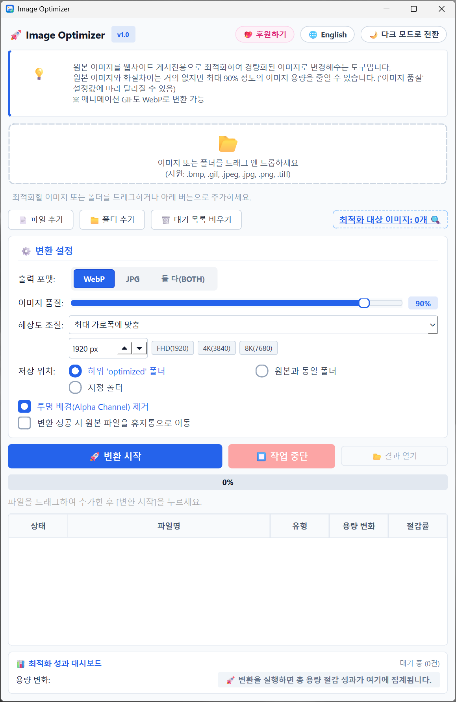
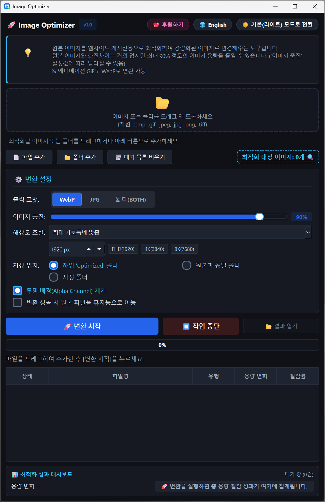

# 🚀 Image Optimizer (이미지 옵티마이저)

<div align="center">

<p>
  <a href="README.md"><b>English</b></a> • <b>한국어 (Korean)</b>
</p>

[](LICENSE)
[](LICENSE)
[](https://www.python.org/)
[-41cd52.svg)](https://www.qt.io/)
[](#-지원-플랫폼)
[](#-개발자-후원하기)

**웹과 데스크톱을 위한 올인원 크로스 플랫폼 이미지 & 애니메이션 최적화 도구**  
*초고효율 WebP / JPG 변환, 움직이는 GIF 애니메이션 최적화, 투명 배경 보존 및 스마트 리사이징*

[스크린샷](#-스크린샷-screenshots) • [주요 기능](#-주요-기능-key-features) • [지원 플랫폼](#-지원-플랫폼-platform-support) • [다운로드](#-설치-및-다운로드-installation--downloads) • [소스코드 빌드](#-소스코드-실행-및-빌드) • [후원하기](#-개발자-후원하기-sponsor)

</div>

---

## 🌟 개요 (Overview)

**Image Optimizer**는 원본 이미지의 우수한 시각적 화질을 그대로 유지하면서 파일 용량을 최대 90%까지 경량화하여, 웹사이트 로딩 속도와 스토리지 효율을 극대화하는 **무료 크로스 플랫폼 데스크톱 도구**입니다.

일반 정지 이미지(`PNG`, `JPG`, `BMP`, `TIFF` 등)뿐만 아니라 **움직이는 GIF(움짤)**의 모든 프레임과 타이밍을 온전히 보존하는 **애니메이션 WebP 변환**을 완벽하게 지원합니다.

---

## 📸 스크린샷 (Screenshots)

<div align="center">

| ☀️ 기본 라이트 모드 (Light Mode) | 🌙 다크 모드 (Dark Mode) |
| :---: | :---: |
| <a href="images/screenshot_normal_kor.png"></a> | <a href="images/screenshot_dark_kor.png"></a> |

*💡 상단 헤더의 테마 전환 버튼(☀️/🌙)으로 언제든지 원클릭으로 라이트 모드와 다크 모드를 전환할 수 있습니다.*

</div>

---

## ✨ 주요 기능 (Key Features)

- ⚡ **초고효율 포맷 변환**
  - `WebP`: 원본 대비 최대 90% 용량 절감
  - `JPG`: 뛰어난 호환성의 고화질 압축
  - `둘 다(BOTH)`: WebP와 JPG를 동시에 한 번에 생성 (웹 최적화 및 레거시 대응)
- 🎞️ **움직이는 GIF (움짤) 애니메이션 최적화**
  - 모든 프레임과 재생 속도를 100% 보존하며 용량을 획기적으로 줄여주는 **애니메이션 WebP** 변환
  - 첫 프레임을 추출하여 정지 이미지 JPG로 변환하는 모드 지원
- 📐 **스마트 해상도 조절 & SNS / 인플루언서 맞춤 프리셋**
  - 🌟 **SNS / 인플루언서 프리셋 (NEW)**: 유튜브 썸네일(16:9), 쇼츠/릴스(9:16), 인스타 피드(1:1 / 4:5), 블로그 본문(1200px) 등 주요 플랫폼 공식 규격 원클릭 맞춤 변환 & 스마트 중앙 크롭 지원
  - **최대 가로폭에 맞춤 (Fit Max Width)**: 4K, FHD, HD 등 가로폭 초과 시 비율을 유지하며 자동 축소
  - **비율(%) 축소 (Scale %)**: 25%, 50%, 75% 등 원하는 배율로 직관적 축소
  - **원본 크기 유지 (100%)**: 해상도 변경 없이 순수 포맷 압축만 수행
- 🎨 **투명 배경(Alpha Channel) 보존 / 제거 선택**
  - 투명 배경을 100% 유지하며 WebP로 압축하거나, 필요 시 흰색 배경으로 합성
- 🌈 **광색역(Display P3 / Adobe RGB) 표준 sRGB 자동 변환**
  - LittleCMS 엔진을 통해 Figma, Photoshop, 아이폰 등에서 작업한 광색역 이미지의 픽셀을 표준 sRGB로 정밀 변환하여, 인스타/카톡/블로그 등 모든 SNS와 모니터에서 **색감 물 빠짐 없는 100% 원본 색감 보장**
- 🌐 **원클릭 다국어 지원 (Bilingual UI)**
  - 상단 버튼 클릭 한 번으로 **한국어 ↔ English** 즉시 전환 (설정 자동 저장)
- 🌗 **다크 모드 & 라이트 모드 테마**
  - 눈이 편안한 세련된 다크 테마 및 깔끔한 라이트 테마 지원
- 🗑️ **안전한 원본 파일 처리**
  - 영구 삭제 위험 없이 **시스템 휴지통(Trash)**으로 안전하게 이동
- 📊 **실시간 성과 대시보드**
  - 변환 성공 건수, 총 절약된 용량(MB), 평균 절감률(%)을 실시간으로 집계 및 시각화
- 💖 **원클릭 후원 연동**
  - 앱 헤더 바에 탑재된 `💖 후원하기` 버튼으로 개발자 GitHub Sponsors 페이지 바로가기 지원

---

## 💻 지원 플랫폼 (Platform Support)

| 플랫폼 | 아키텍처 | 설치 및 패키지 형식 | 지원 상태 |
| :--- | :--- | :--- | :--- |
| **Windows 11 / 10** | x64 (AMD64) | 무설치 단일 파일 (`.exe`) / 설치 마법사 | ✅ 지원 완료 |
| **macOS (Apple Silicon & Intel)** | Universal (M1/M2/M3/M4 & Intel) | **Homebrew Cask** / 디스크 이미지 (`.dmg`) | ✅ 지원 완료 |
| **Linux (Debian, Ubuntu, Mint)** | x86_64 | **APT 데비안 패키지 (`.deb`)** / 단일 바이너리 | ✅ 지원 완료 |
| **Linux (라즈베리 파이, ARM SBC)** | ARM64 (aarch64) | **APT 데비안 패키지 (`.deb`)** / 단일 바이너리 | ✅ 지원 완료 |

---

## 📥 설치 및 다운로드 (Installation & Downloads)

### 🪟 Windows 환경 (포터블 실행 파일 및 설치 마법사)
**[GitHub Releases](https://github.com/smin987/ImageOptimizer/releases/latest)**에서 최신 단일 실행 바이너리(`ImageOptimizer.exe`) 또는 설치 마법사를 직접 내려받거나, `winget`으로 설치할 수 있습니다:
```powershell
winget install smin987.ImageOptimizer
```

### 🍺 macOS 환경 : Homebrew를 통한 원클릭 설치
[Homebrew](https://brew.sh/)를 사용하면 Mac 터미널에서 명령어 한 줄로 편리하게 설치할 수 있습니다:
```bash
brew install --cask https://raw.githubusercontent.com/smin987/ImageOptimizer/main/build/homebrew/Casks/image-optimizer.rb
```

### 🐧 리눅스 환경 : 공식 APT 저장소 등록 (자동 업데이트 지원)
공식 APT 저장소를 등록해 두면 `apt upgrade` 시 항상 최신 버전으로 자동 업데이트됩니다:
```bash
# 1. 저장소 공개키 등록
curl -fsSL https://smin987.github.io/ImageOptimizer/repo.key | sudo gpg --dearmor -o /etc/apt/keyrings/image-optimizer.gpg

# 2. 저장소 소스 추가
echo "deb [signed-by=/etc/apt/keyrings/image-optimizer.gpg] https://smin987.github.io/ImageOptimizer ./" | sudo tee /etc/apt/sources.list.d/image-optimizer.list

# 3. 설치 및 자동 업데이트
sudo apt update && sudo apt install image-optimizer
```
> *단일 `.deb` 패키지만 다운로드하여 직접 설치하시려면 [GitHub Releases](https://github.com/smin987/ImageOptimizer/releases)에서 다운로드 후 `sudo apt install ./ImageOptimizer_*_amd64.deb` (또는 `arm64.deb`)를 실행하세요.*

### 📦 무설치 포터블 단일 파일 (Direct Downloads)
별도의 설치 과정 없이 다운로드 후 바로 사용하시려면 **[GitHub Releases](https://github.com/smin987/ImageOptimizer/releases)**에서 다운로드하세요:

- **Windows**: `ImageOptimizer-windows-x64.exe` (다운로드 후 더블클릭으로 즉시 실행)
- **macOS**: `ImageOptimizer-macos.dmg` (열어서 응용 프로그램 폴더로 드래그 앤 드롭)
- **Linux x86_64**: `ImageOptimizer-linux-x86_64` (실행 권한 부여 후 실행: `chmod +x`)
- **Linux ARM64**: `ImageOptimizer-linux-arm64` (라즈베리 파이 4/5 및 ARM64 SBC용)

---

## 🛠️ 소스코드 실행 및 빌드

### 1. 요구 사항
- Python 3.10 이상

### 2. 직접 실행
```bash
# 저장소 복제
git clone https://github.com/smin987/ImageOptimizer.git
cd ImageOptimizer

# 필수 패키지 설치
pip install -r requirements.txt

# 앱 실행
python main_gui.py
```

### 3. 로컬 독립 실행 파일 빌드
- **Windows**: `build\build_windows.bat` 실행
- **Linux**: `bash build/build_linux.sh` 실행
- **macOS**: `bash build/build_macos.sh` 실행

---

## 💖 개발자 후원하기 (Sponsor)

**Image Optimizer**는 누구나 자유롭게 사용할 수 있는 **무료 소프트웨어(Source-Available Freeware)**입니다.  
이 프로그램이 유용하셨거나 지속적인 기능 업데이트, 성능 개선, 멀티플랫폼 지원을 응원하고 싶으시다면 커피 한 잔의 따뜻한 후원을 부탁드립니다! 여러분의 따뜻한 후원은 프로젝트를 유지하는 데 매우 큰 힘이 됩니다. ☕✨

<div align="center">

[](https://github.com/sponsors/smin987)
[](https://www.buymeacoffee.com/smin987)
[](https://ko-fi.com/smin987)

</div>

---

## 📄 라이선스 (License)

본 소프트웨어는 **[Image Optimizer Fair-Code 라이선스](LICENSE)** (Source-Available Freeware)에 따라 배포됩니다:
- **소스코드(Source Code)**:
  - **개인, 학생, 교육 및 비영리 단체**: 투명한 보안 검증, 감사, 개인 연구/학습 및 **공식 저장소 기여(Pull Request) 목적의 로컬 수정은 자유롭게 허용**됩니다.
  - **영리 단체 및 기업 사용자**: 보안 검토 및 감사 목적의 소스코드 열람은 허용되나, **소스코드의 무단 수정(Modification) 및 커스텀 빌드 제작은 엄격히 금지**됩니다. (기업 사용자는 공식 배포된 무료 바이너리를 이용해야 합니다.)
  - **공통**: 경쟁 제품을 출시하기 위한 소스코드 수정 및 무단 배포는 엄격히 금지됩니다. (단, 제3자 오픈소스의 경우 해당 라이선스의 고지를 따릅니다.)
- **실행 산출물(바이너리)**: 공식 빌드된 실행 파일(`.exe`, `.dmg`, `.deb`, Linux 독립 바이너리)은 **개인, 교육 기관, 비영리 단체뿐만 아니라 영리 기업 및 상업 회사 누구나 100% 영구 무료(프리웨어)**로 업무 및 상업 환경에서 자유롭게 사용할 수 있습니다.

### 제3자 오픈소스 라이선스 고지 (Third-Party Open Source Notices)
본 소프트웨어는 Qt/PySide6 (LGPLv3), Pillow (HPND), Send2Trash (BSD-3), Python (PSF) 등 훌륭한 오픈소스 컴포넌트를 기반으로 제작되었습니다.
각 컴포넌트의 상세 저작권 고지, 라이선스 전문 링크 및 LGPLv3 라이브러리 교체 권리 안내는 **[THIRD_PARTY_LICENSES.md](THIRD_PARTY_LICENSES.md)**를 참조하세요.
